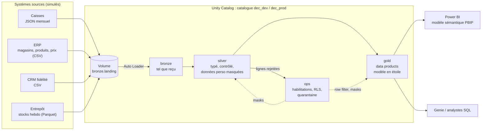
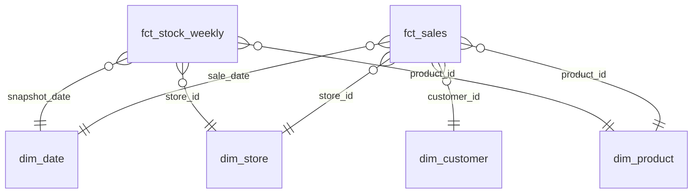

# Architecture de la démo

Plateforme data d'une enseigne de bricolage multi-magasins, construite comme projet de démonstration. Toutes les données sont fictives et produites par un générateur reproductible.

## Vue d'ensemble

Un seul pipeline Lakeflow (`dec_demo_etl`, en SQL) porte toute la chaîne bronze → silver → gold, plus la quarantaine. La Free Edition n'autorise qu'un pipeline actif par type.

## Couches et objets

| Couche | Objets | Rôle |
|---|---|---|
| Volume `bronze.landing` | `stores/`, `products/`, `product_price_changes/`, `customers/`, `sales/file_month=AAAA-MM/`, `stock_snapshots/` | Zone de réception des exports sources |
| `bronze` | `stores`, `products`, `product_price_changes`, `customers`, `sales`, `stock_snapshots` | Ingestion incrémentale (Auto Loader), données telles que reçues + `_source_file`, `_ingested_at` |
| `silver` | `stores`, `customers`, `sales`, `stock_snapshots`, `products_history` | Typage, dédoublonnage, contrôles qualité. `products_history` : historique des prix en SCD2 par AUTO CDC |
| `gold` | `fct_sales`, `fct_stock_weekly`, `dim_store`, `dim_product`, `dim_customer`, `dim_date` | Data products documentés, certifiés, sécurisés |
| `ops` | `security_region_access`, `rf_region`, `mask_email`, `mask_phone`, `mask_last_name`, `quarantine_sales` | Sécurité et supervision de la qualité |
| `migration` | sorties SAS legacy, réconciliation | Migration SAS → Databricks |

## Modèle en étoile (gold)

- `fct_sales` : une ligne par ligne de ticket. Mesures : quantité, CA net, coût d'achat, marge brute. Le prix catalogue en vigueur à la date de vente vient d'une jointure temporelle sur `silver.products_history`.
- Membres techniques : `UNKNOWN` dans `dim_product` (référence absente du catalogue, la vente est conservée) et `ANONYMOUS` dans `dim_customer` (vente non identifiée).
- `dim_customer` ne contient aucune donnée personnelle. Les noms, emails et téléphones restent en silver, masqués.

## Qualité des données

| Étape | Contrôle | Action |
|---|---|---|
| `silver.sales` | magasin renseigné, quantité > 0, date valide, prix > 0 | ligne rejetée |
| `silver.sales` | remise entre 0 et 50 % | alerte |
| `gold.fct_sales` | prix encaissé ≤ 1,5 × prix catalogue en vigueur | ligne rejetée |
| `gold.fct_sales` | produit présent au catalogue | alerte, ligne conservée en `UNKNOWN` |
| `silver.customers` | email bien formé, segment connu | alerte |

Chaque ligne rejetée ou suspecte apparaît dans `ops.quarantine_sales` avec son motif, l'étape qui l'a détectée et le fichier source. C'est le point d'entrée du support N2. Les métriques des contrôles sont visibles dans l'onglet Data quality du pipeline et dans son event log.

## Sécurité

- **Sécurité ligne** : `ops.rf_region(row_region)` est attachée à `fct_sales`, `fct_stock_weekly` et `dim_store`. Une ligne est visible si l'utilisateur appartient à un groupe habilité pour sa région dans `ops.security_region_access` (ou pour `*`).
- **Une seule source d'habilitations** : la même table doit alimenter la RLS Power BI, pour qu'un utilisateur voie les mêmes données dans Databricks et dans les rapports.
- **Masquage** : `mask_email`, `mask_phone` et `mask_last_name` sur `silver.customers`. Les données apparaissent en clair uniquement pour `dec_pii_readers`.
- **Droits** : moindre privilège, les consommateurs n'accèdent qu'à gold. L'état cible, par groupes, est décrit dans `sql/governance/target/30_grants_target.sql`. En Free Edition, faute de groupes de compte, les GRANT visent `account users`, et le filtrage fin repose sur les row filters et les masks.

## Déploiement et orchestration

| Élément | Fichier | Contenu |
|---|---|---|
| Bundle | `databricks.yml` | Cibles `dev` (catalogue `dec_dev`) et `prod` (catalogue `dec_prod`) |
| Pipeline | `resources/dec_demo_etl.pipeline.yml` | Pipeline serverless, SQL dans `src/dec_demo_etl/transformations/` |
| Job | `resources/dec_demo_platform.job.yml` | `governance_setup` → `refresh_pipeline` → `publish_data_products`, quotidien, alerte mail en cas d'échec |
| Gouvernance | `sql/governance/*.sql` | DDL idempotent exécuté par `dec_demo.governance` |
| Données de démo | `src/dec_demo/generate.py` | Générateur Spark déterministe (même graine = mêmes données) |

Contrôles avant fusion : `ruff`, `sqlfluff` (dialecte databricks), `pytest`, `databricks bundle validate`.

## Scénarios intégrés aux données

1. **Rupture d'approvisionnement** : du 6 avril au 17 mai 2026, les 60 références Jardin les plus vendues sont en rupture dans les 7 magasins de la région NORD. Le CA Jardin d'avril-mai NORD baisse de 52 % sur un an, pendant qu'il progresse de 3 % ailleurs.
2. **Incident de données** : le 14 octobre 2026, l'export caisse du magasin de Metz envoie les prix en centimes. Le contrôle `price_consistent_with_catalog` écarte ces lignes de gold et les place en quarantaine. Voir le runbook N2.
